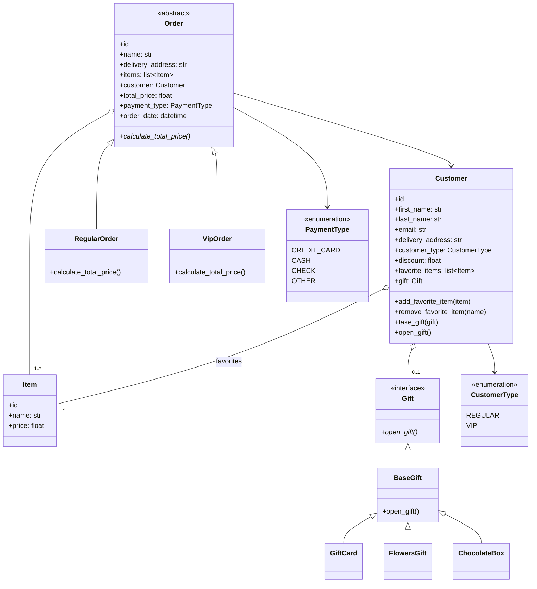

# Python OOP – Second Exam (Moed A)
## Customer's Order Management System

### Project structure
```
order_system/
    enums.py        PaymentType (CREDIT CARD / CASH / CHECK / OTHER), CustomerType (REGULAR / VIP)
    exceptions.py   DuplicateIdError, NotVipCustomerError, InvalidValueError
    unique_id.py    UniqueIdMixin – enforces unique ids per class
    item.py         Item (id, name, price)
    gift.py         Gift interface (open_gift) + concrete gifts
    customer.py     Customer (favorites, take_gift, open_gift)
    order.py        Order (abstract) -> RegularOrder, VipOrder
bonus/
    animals.py      Animal (abstract), Pet (interface), Spider, Cat, Fish
tests/
    test_system.py  20 unit tests
main.py             Demo
```

### Run
```bash
python main.py
python -m unittest discover -s tests -t .
```

### Design decisions
- **Order** is an abstract class. Its constructor calls the abstract method
  `calculate_total_price()`, implemented by `RegularOrder` (sum of item prices)
  and `VipOrder` (sum minus the customer's discount, a number between 0 and 1, e.g. 0.05 = 5%).
- **VipOrder** checks that the customer is VIP *before* calculating the price,
  otherwise it raises `NotVipCustomerError`.
- A customer `discount` can be `None`; a VIP with no discount pays full price.
- **Unique ids**: items, customers and orders each keep a registry of used ids.
  `RegularOrder` and `VipOrder` share the same registry. A rejected order does
  not consume its id. An order cannot contain the same item twice.
- **Favorite items**: creating an order adds its items to the customer's
  favorites. Items are compared by name (case-insensitive), so two items with
  the same name and different ids are the same item. Customers can add and
  remove favorites; the list is exposed as a copy to protect encapsulation.
- **Gift** is an interface (ABC with abstract `open_gift()`), so a gift can be
  of any type as long as it implements it. `take_gift(gift)` stores it and
  `open_gift()` opens it if the customer has one.
- **Bonus**: `#legs` in the UML is protected (`_legs`). Python has no method
  overloading, so `Cat(name)` and `Cat()` are one constructor with a default
  value. `Fish` overrides `walk()` because it has no legs.


### Class diagram

